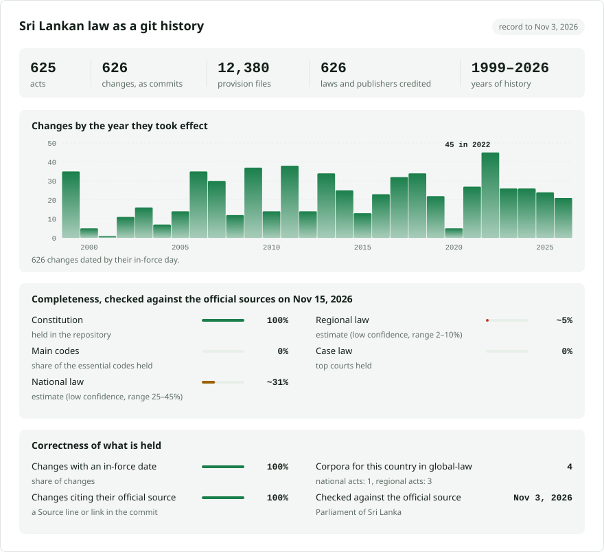

# Sri Lanka: law history in git

<picture>
<source media="(prefers-color-scheme: dark)" srcset="data/effort-dark.svg">

</picture>

The law of Sri Lanka as a git history: one file per article or section, one commit per version on the day it took effect, and the law that made each change as the commit's author. `git blame` names the law behind every line; `git log` lists every change to a provision; picking a date gives the text in force that day.

Part of [lexifina/global-law](https://github.com/lexifina/global-law), one git history for every country's law: this is Sri Lanka's national law, which global-law reads at `sri-lanka/national/acts/`.

**What is in it now** (2026-11-27): the Constitution, 267 provisions in 2 versions; 771 Acts of Parliament and 4 Laws of the National State Assembly, enacted from 1961 to 2026, each as enacted. [`REPRODUCE.md`](REPRODUCE.md) lists the sources; [`data/laws.csv`](data/laws.csv) gives each law's days and its source page.

The Constitution is [`constitution/constitution/`](constitution/constitution/), one file per Article and Schedule; each Act is in `act/<year>/<number>/`, each Law of 1972-1978 in `law/<year>/<number>/` and each Ordinance in `ordinance/<year>/<number>/` (the Penal Code, Ordinance No. 2 of 1883, is `ordinance/1883/002/`), one file per section, a `preamble.md` for the long title and enacting words, and one file per Schedule (`act/2007/007/` is the Companies Act, No. 07 of 2007). Commits before 10 November 2026 hold each act under its id (`constitution/`, `act-2007-007/`); `data/paths.json` maps each id to its folder.

The text is in English, as Parliament publishes it. Laws are enacted in Sinhala and Tamil with an English translation, and Parliament decides which text prevails (Article 23 of the Constitution); the Sinhala and Tamil texts are not part of this record.

## Questions as git commands

| Question | Command |
| --- | --- |
| Every change to Article 137 of the Constitution | `git log -p --word-diff --follow --diff-filter=AM -- constitution/constitution/art-137.md` |
| Which law wrote each line of Article 137? | `git blame constitution/constitution/art-137.md` |
| Every version of the Constitution, with the day each took effect | `git log --diff-filter=r --format="%h %(trailers:key=In-force,valueonly,separator=) %an" -- constitution ':!*/README.md'` |
| Article 137 in one of those versions | `git show <commit>:constitution/art-137.md` |

**Outside git**, we also host this record publicly, for free:

- **[Ask Claude about Sri Lankan law](https://global-law.lexifina.com/v1/try_claude?country=sri-lanka)**: opens Claude with a first question ready.
- **[Ask ChatGPT](https://global-law.lexifina.com/v1/try_chatgpt?country=sri-lanka)**: the same question in ChatGPT.
- **[Search Sri Lankan law on our site](https://lexifina.com/law?country=sri-lanka&q=minimum+wage)**: a search for "minimum wage", with each provision's text and its versions, no account needed.
- **[Developer REST API](https://global-law.lexifina.com/v1/search_law?query=minimum+wage&jurisdiction=sri-lanka)**: the same search as JSON, with no key. See the [documentation here](https://lexifina.com/api/global-law).

Both assistants read the record through the free Global law connector (MCP, `https://global-law.lexifina.com/mcp`); the first time, the chat gives you the link that adds it. Ask in English.

**Host it yourself easily.** All it takes is git and Python, and the tools run on your machine:

```sh
git clone --depth 1 https://github.com/lexifina/global-law && cd global-law
python3 tools/countries.py add sri-lanka/national/acts
python3 tools/law.py show 2026-01-01 sri-lanka/national/acts/constitution/constitution/art-137.md
```

Opened in Claude Code, Cursor, VS Code or Codex, the clone also starts a local MCP server with the same tools ([MCP.md](https://github.com/lexifina/global-law/blob/main/MCP.md)).

## Dates

Each commit is dated at noon, Asia/Colombo, on the day the version took effect, and carries it in its `In-force:` trailer:

- an Act, by the day of the Speaker's certificate printed on it ("[Certified on ...]"): a Bill becomes law when the certificate is endorsed on it (Article 80(1) of the Constitution). Where an Act, or part of it, comes into operation later, on a day a Minister appoints by Order, that day is not shown;
- the Constitution's first version, by its edition: the Parliament's consolidated edition as amended up to 31 October 2022 (the Twenty First Amendment);
- the Twenty Second Amendment, which changes Articles 107 and 137, by its Speaker's certificate, 25 September 2026;
- an Act or Law taken from LawNet's "Acts 1956-2006 (Official)", by its endorsed (certified) day in Parliament's Acts listing;
- a consolidated text (a revised-edition chapter or LawNet's consolidated statutes), by the certified day of the last amending law its header lists, the earliest day that text can be in force; where the header lists only the enactment itself, by the commencement day printed under its title. A consolidation whose last amending law is an Ordinance (no day in Parliament's listing) is held back;
- before 1970, git cannot hold the date: such commits are stamped 1970-01-01 and the real day is in the subject and the `In-force:` trailer.

Each law is credited to itself (`Act No. 33 of 1999 <act-1999-033@parliament.lk.invalid>`), with an e-mail address that cannot exist, so `git blame` and `git log --author` name laws. The Constitution's first version is credited to the publisher, the Parliament of Sri Lanka, because earlier editions are not built. The committer is always Lexifina.

## How it is checked

- Each Act is read from its PDF's text layer. Every printed word from the long title to the end of the Act is in a file, checked letter for letter, except running heads, page numbers, printer's codes, the certificate line and Part and Chapter headings; an Act whose sections are not numbered 1, 2, 3 and so on without a gap is left out.
- All 267 provisions of the Constitution's first version were compared word by word with an independent text extraction of the edition's PDF; the Twenty Second Amendment's two changes match the words of the Act.
- `tools/append.py` adds new Acts on top of main only after checking that main's newest text of every act equals the corpus; `tools/check_repo.py` reads every version back from git and compares it with the corpus. [`REPRODUCE.md`](REPRODUCE.md) records no full check or second build of this build yet.
- History is append-only: new acts go on top, and no published commit is rewritten.
- [vulnerabilities/](vulnerabilities/): possible drafting mistakes in this law, found by global-law's detectors and checked by hand. Not run yet.

## What it does not show

- **Amendments to Acts.** Each Act is held as enacted; an amending Act is its own folder and its changes are not replayed into the Act it amends, because Parliament publishes no consolidated text. Only the Constitution has more than one version.
- **Older law, in part.** Parliament's own PDFs of Acts before 1999 are scans without a text layer and are not read (no OCR). Older law comes from LawNet (Ministry of Justice), whose site is gone and whose pages are read from the Wayback Machine (`Source-status: secondary copy` in each commit); pages LawNet published only as PDF images, consolidations that cannot be dated, and pages whose sections cannot be numbered without a gap are left out.
- **The Constitution's earlier history.** The 1978 text and the First to Twenty First Amendments are not separate commits.
- **Act No. 29 of 2021.** Its folder, `act/2021/029/`, holds the text of Act No. 23 of 2022, the same Act as `act/2022/023/`.
- **Other law.** Regulations, case law and bills are not here; provincial statutes are in their own repositories (global-law's `sri-lanka/northern/`, `sri-lanka/central/` and `sri-lanka/uva/`).

## Sources

| Source | Kind | Past versions | Notes |
| --- | --- | --- | --- |
| [Parliament of Sri Lanka: the Constitution](https://www.parliament.lk/en/constitution/main) | Unofficial consolidated English edition, and the Twenty Second Amendment | yes, editions as amended up to the Seventeenth to Twenty First Amendments; only the last is used | The Amendment's changes replayed onto Articles 107 and 137 |
| [Parliament of Sri Lanka: Acts listing](https://www.parliament.lk/en/business-of-parliament/acts-listing) | Acts of Parliament (public and private), English text as printed by the Department of Government Printing | no, the Act as enacted | Read from the PDFs' text layer (no OCR) |
| [LawNet](https://web.archive.org/web/2024/https://www.lawnet.gov.lk/) (Ministry of Justice), via the Wayback Machine | Acts 1956-2006 (Official); Legislative Enactments 1956 and 1980; Consolidated Statutes up to 2006 (unofficial) | yes, one version per edition | The live site now serves only a parked host page; secondary copy |

## Licence

See [`LICENSE`](LICENSE). parliament.lk states no licence; under section 8 of the Intellectual Property Act, No. 36 of 2003, official texts of a legislative, administrative or legal nature are not protected. Lexifina's own contributions (the arrangement of the history, the commit messages, the tables and the tools) are CC0 1.0.

No AI model wrote, translated or corrected legal text, and none runs when the history is built; the scripts were written by an AI model (see [`REPRODUCE.md`](REPRODUCE.md)).

## Visualisations

- [visualisations/](visualisations/): charts drawn from this repository. Not drawn yet.

## More

From [lexifina/global-law](https://github.com/lexifina/global-law):

- [FEATURES.md](https://github.com/lexifina/global-law/blob/main/FEATURES.md): every feature, and what every corpus must support (`git blame`, `law.py`, the MCP tools)
- [FAQ.md](https://github.com/lexifina/global-law/blob/main/FAQ.md): questions and answers · [CONTRIBUTING.md](https://github.com/lexifina/global-law/blob/main/CONTRIBUTING.md): proposing changes · [MCP.md](https://github.com/lexifina/global-law/blob/main/MCP.md): the MCP server · [REPRODUCE.md](https://github.com/lexifina/global-law/blob/main/REPRODUCE.md): how it was built · [CHANGELOG.md](https://github.com/lexifina/global-law/blob/main/CHANGELOG.md)
- [FRESHNESS.md](https://github.com/lexifina/global-law/blob/main/FRESHNESS.md): how current each corpus is · [Monitoring](https://github.com/lexifina/global-law/tree/main/monitoring): whether updates are running · [WATCHING.md](https://github.com/lexifina/global-law/blob/main/WATCHING.md): how each official source is watched for changes
- [performance/](https://github.com/lexifina/global-law/tree/main/performance): how fast the tools are, measured
- [visualisations/](https://github.com/lexifina/global-law/tree/main/visualisations): charts and bridges across the world's law
- [Vulnerabilities](https://github.com/lexifina/global-law/tree/main/vulnerabilities): mistakes in legislation as published
